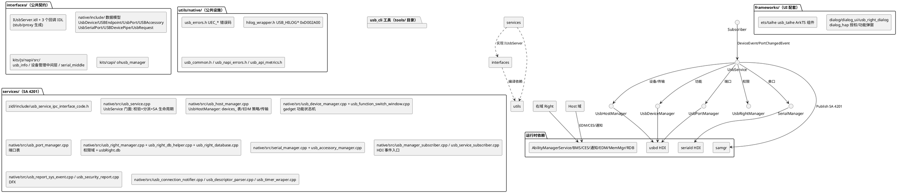

# 架构设计及约束

> 模块：usb_manager。源码路径相对仓根。

## 架构设计

### 设计原则

| 原则 | 描述 | 理由 |
|---|---|---|
| 特性开关分域编译 | 六个 declare_args（usbmgr.gni:20-29）驱动 USB_MANAGER_FEATURE_HOST/DEVICE/PORT、USB_MANAGER_PASS_THROUGH 宏，IDL 方法带 [macrodef] 条件（interfaces/innerkits/IUsbServer.idl:29-104），服务类成员与方法整体包裹在宏内（usb_service.h:103-202） | 单一组件按产品形态裁剪（仅 host、仅 device 等），一套代码覆盖标准/精简产品 |
| IDL 单一真源 | SA 方法以 interfaces/innerkits/IUsbServer.idl 为源生成 stub/proxy；IPC 码枚举 `UsbInterfaceCode` 0-67（services/zidl/include/usb_service_ipc_interface_code.h:22-91）；zidl 目录不放手写实现 | 线序协议跨版本兼容；AGENTS.md 亦列为生成代码边界 |
| HDI 双模接入 | `usb_manager_pass_through=true`：按域拆分为 V2_0 IUsbHostInterface（服务名 "usb_host_interface_service"，usb_host_manager.cpp:126/162）+ IUsbDeviceInterface + IUsbPortInterface；false：统一 V1_2 IUsbInterface | pass-through 对应 HDI 代理 2.0（sa_profile/4201.json:11 锁定 libusb_proxy_2.0），非直通走 1.x HAL；两模式覆盖方法成对出现（如 usb_host_manager.cpp:317-334 OpenDevice 的双分支） |
| 管理器分域 | UsbService 仅做权限校验、参数转换与分派；业务状态各归其域：devices_（host）、currentFunctions_（device）、portMap_（port）、usbRight.db（right）、serialPortMap_（serial） | 3800 行的 usb_service.cpp 保持"门面"角色，域内状态自治、锁粒度最小化 |
| 按需加载与自回收 | on-demand 拉起（services/usb_service.cfg:5，condition `bootevent.wms.fullscreen.ready=true`）；30 秒定时器无负载即 UnloadSystemAbility（usb_service.cpp:71 `UNLOAD_SA_TIMER_INTERVAL`、usb_service.cpp:3330 `UnLoadSelf`）；与 MemMgr SetCritical 联动（usb_service.cpp:3366-3372） | 4111KB ROM/6660KB RAM（bundle.json:34-35）按需驻留；弹窗类系统依赖就绪后才拉起 |
| 失败可观测 | 几乎每个业务分支落 HiSysEvent（TRANSFER_FAULT/OPERATION_FAULT/SERIAL_OPERATION 等）或 USB_HILOG；SA 启动等 CES 就绪重试 10 次（usb_service.cpp:68-69） | USB 故障定位强依赖现场数据（AGENTS.md DFX 约束） |

### 逻辑架构

> 图中组件标签为所属 package 目录内的相对路径（如 services/ 包内的 [native/src/...] 指 services/native/src/ 下同名文件、interfaces/ 包内的 [kits/js/napi/...] 指 interfaces/kits/js/napi/ 下同名文件）；[右域 Right] 为 `usb_right_manager.cpp` 等权限域组件的简称。

调用链要点（输入→分发→处理→输出）：

1. **应用打开设备**：JS `connectDevice`（usb_info.cpp:3189）→ `UsbSrvClient::OpenDevice` → IPC USB_FUN_OPEN_DEVICE(3) → `UsbService::OpenDevice`（usb_service.cpp:558）：`CheckDevicePermission`（HasRight 链）→ `UsbHostManager::OpenDevice` → HDI `usbHostInterface_->OpenDevice`；成功后 `AddDeviceConnection` 记录连接并通知监听者（usb_service.cpp:585/759-789）。
2. **热插拔**：usbd → `UsbManagerSubscriber::DeviceEvent`（usb_manager_subscriber.cpp:79）→ `UsbService::DeviceEvent`（usb_service.cpp:3496）：DEVUP→`AddDevice`（读设备描述符建 UsbDevice，usb_service.cpp:1302-1332）→ `UsbHostManager::AddDevice`（NEW_ARRIVED→ExecuteStrategy→ENABLED/DISABLED→发布 ATTACHED 事件，usb_host_manager.cpp:1473-1525）；DEVDOWN→`DelDevice`（清连接/claim/权限/表项，usb_service.cpp:1336-1368）。
3. **权限请求**：`RequestRight`（usb_service.cpp:2355）→ `UsbRightManager::RequestRight`（usb_right_manager.cpp:222）：HasRight→未授权则 `GetUserAgreementByDiag`（usb_right_manager.cpp:238，dialogRunning_ 互斥保证同时仅一弹窗）→ `ShowUsbDialog`（usb_right_manager.cpp:254）：组装参数 → ConnectAbility 连接 sceneboard systemdialog（usb_right_manager.cpp:192-219）→ `UsbAbilityConn::OnAbilityConnectDone` 以 cmdCode=1 发送参数 JSON（含 `sysDialog/common` uiExtensionType，usb_right_manager.cpp:1067-1122）→ sem_wait 等待用户操作 → 弹窗侧经 NAPI `addDeviceAccessRight` 落库 → OnAbilityDisconnectDone sem_post（usb_right_manager.cpp:1124-1131）→ 重查 HasRight。
4. **gadget 功能切换**：`SetCurrentFunctions`（usb_service.cpp:2571：CheckSysApiPermission→HasSetFuncRight→SetSettingsDataHdcStatus）→ `UsbDeviceManager::SetCurrentFunctions`（usb_device_manager.cpp:201：读旧值→相同即幂等返回→HDI 设置→UpdateFunctions）。连接/断开事件经 `HandleEvent` 延迟任务（DELAY_CONNECT/ DISCONN_INTERVAL 定时器，usb_device_manager.cpp:416-466），断开时自动回退 MTP/PTP 为 STORAGE；`ProcessFuncChange` 触发功能选择弹窗（UsbFunctionSwitchWindow，usb_function_switch_window.cpp:130）与通知。
5. **异步传输**：`UsbSubmitTransfer`（usb_service.cpp:2097）：参数/权限/独占校验 → `Ashmem(fd, memSize)` 封装 → `UsbHostManager::UsbSubmitTransfer`（usb_host_manager.cpp:1079）→ HDI；调用方进程死亡由 `UsbSubmitTransferDeathRecipient` 兜底 Cancel+Close（usb_host_manager.cpp:207-215）。

### 非功能设计

| 场景类别 | 方案设计 |
|---|---|
| 启动时序 | OnStart：CES 就绪重试（COMMEVENT_REGISTER_RETRY_TIMES=10，usb_service.cpp:68/408-423）→ WaitUsbdService 最多 60 秒等 usbd（usb_service.cpp:70/285-301）→ 各域 Init → SubscribeSystemAbility（自死亡监听解绑）→ Publish（usb_service.cpp:305-404） |
| 并发安全 | 域级锁：devices_ 用 shared_mutex（usb_host_manager.h:237）；权限 DB `databaseMutex_`（usb_right_db_helper.h:130）；claim/serial/accessory/deviceListener/deviceConnection 各有独立 mutex（usb_service.h:374-434）；弹窗互斥 `dialogRunning_`（usb_right_manager.h:109） |
| 失败恢复 | usbd 死亡：`UsbdDeathRecipient::OnRemoteDied` 卸载自身 SA 重建（usb_service.cpp:3380-3393）；EDM SA 按需 LoadSystemAbility 异步拉起（usb_host_manager.cpp:2031-2048）；客户端 `UsbSrvClient` 带 DeathRecipient 与 Connect(force) 重连（usb_srv_client.h:153-165） |
| 资源安全 | 传输 fd 失败路径统一 `::close(fd)`（usb_service.cpp:2102-2104 等）；串口/附件/claim 三类会话各有 DeathRecipient 在客户端死亡时回收（SerialDeathRecipient usb_service.cpp:3396、AccessoryDeathRecipient（usb_service.cpp:3407）、ClaimDeathRecipient（usb_service.cpp:3435））；设备拔出统一 `RemoveAllDeviceConnections/RemoveAllClaimByDevice`（usb_service.cpp:1339-1340） |
| 内存管理 | 与 MemMgr 联动：MEMORY_MANAGER_SA_ID 上线即 SetCritical，活跃设备/连接期间标记关键防杀，空闲时取消再自卸载（usb_service.cpp:274-281/3366-3372） |
| 传输上限 | MEMSIZE_MAX=512MB（usb_service.cpp:78）；串口读 64KB/写 200KB（usb_service.cpp:72-73）；超限返回 UEC_SERIAL_IO_EXCEPTION / UEC_SERVICE_INVALID_VALUE |
| 观测性 | USB_HILOG*（0xD002A00，utils/native/include/hilog_wrapper.h:52-88，8 个子域）；9 个 HiSysEvent（hisysevent.yaml）；安全审计 ReportSerialOperationSecurityInfo（serial_manager.cpp:462）与 DEVICE_SECURITY_POLICY 事件 |

### 构建与特性开关

- 组件 `usb_manager`（subsystem usb，bundle.json:14-15）；SysCap 为 USB 域两个能力（含 Serial 扩展，字面值见 bundle.json:24-27）。
- usbmgr.gni:20-29：`usb_manager_feature_host/device/port`（默认 true，编译宏 USB_MANAGER_FEATURE_*）、`usb_manager_pass_through`（默认 true）、`usb_manager_feature_pop_up_func_switch_model`、`usb_manager_feature_support_cli`（默认 false）；`usb_manager_peripheral_fault_notifier` 随 hdf_external_device_manager 部件存在自动开启（usbmgr.gni:31-33）；`usb_manager_feature_metrics_enable` 随 hiviewdfx_api_metrics（usbmgr.gni:35-37）。
- 产物（bundle.json:73-91）：fwk_group=usbsrv_client、NAPI 三模块（usb_info、设备管理中间层、serial_middle，源文件见 interfaces/kits/js/napi/src/）、ohusb_manager CAPI、dialog_hap、usb_taihe、usb_cli；service_group=usbservice（libusbservice.z.so）、usb_service.init、etc。
- inner_kits 发布 usb_srv_client.h、usb_interface_type.h、iusb_srv.h（bundle.json:92-104）。

## 架构约束

- **IDL 与 IPC 码是线序契约**
  - **what**：增删 SA 方法只能改 interfaces/innerkits/IUsbServer.idl 并重新生成；`UsbInterfaceCode` 0-67 不可重排重编（services/zidl/include/usb_service_ipc_interface_code.h:23-90）；方法带 [macrodef] 宏标注，编译特性必须与宏一致。
  - **why**：跨版本混部下码值漂移将导致方法错位调用；宏不一致会造成客户端与服务端方法集不匹配。
- **pass-through 与 HAL 模式必须成对实现**
  - **what**：所有触达 HDI 的方法都要提供 `#ifdef USB_MANAGER_PASS_THROUGH`（V2_0 分接口）与 `#else`（V1_2 IUsbInterface）双分支（usb_host_manager.cpp 全部方法的双分支模式）；订阅者也要成对（UsbManagerSubscriber/UsbServiceSubscriber）。
  - **why**：特性开关切换即整层 HDI 交互层切换（AGENTS.md Compatibility risks）；漏写单分支在裁剪产品上直接编译失败或运行期空指针。
- **deviceName 双编码不可混用**
  - **what**：服务对外键（HasRight/RequestRight 的 deviceName）是 "busNum-devAddr"；权限库内键（`deviceVidPidMap_` 的 value）是 "VID-PID-Serial"（usb_service.cpp:1321-1327 组装）。`GetDeviceVidPidSerialNumber` 负责转换（usb_service.cpp:2481-2494）；串口另有 serialVidPidMap_ 按 portId 索引（usb_service.cpp:4090-4124）。
  - **why**：busNum-devAddr 重插会变，授权必须绑定 VID-PID-Serial 才能跨插拔生效；混用会导致授权失配或权限误放行。
- **权限校验顺序不可颠倒**
  - **what**：每个入口先 `CheckSysApiPermission`（系统 API，含 API_VERSION_ID_18 分档错误码，usb_service.cpp:3104-3121）或 `CheckDevicePermission`（设备访问权，usb_service.cpp:2304-2312）；Manage* 类还要 `IsCallerValid`（root/EDM UID 3057，usb_service.cpp:3542-3551）。
  - **why**：安全红线（AGENTS.md Do-not-change）；系统应用旁路逻辑（IsSystemAppOrSa，usb_right_manager.cpp:653）也在此链上。
- **错误码分段不可插入**
  - **what**：UEC_INTERFACE_*（offset）与 UEC_SERVICE_*（offset+100）两段枚举（utils/native/include/usb_errors.h:37-108）；NAPI/JS 错误码独立（usb_napi_errors.h、serial_napi_errors.h）。
  - **why**：枚举插入会使后续值全部漂移（历史已发生：UEC_SERVICE_PERMISSION_DENIED_SYSAPI_FAILED 插在段尾 usb_errors.h:96 之后又接串口段）。
- **SA 身份与数据路径固定**
  - **what**：UID usb、SELinux u:r:usb_service:s0、APL system_basic（services/usb_service.cfg:7/23-24）；权限记录路径 /data/service/el1/public/usb_service/right/（cfg:30-31 预建目录，usb_right_database.h:33）；min_hdi_proxy_version 锁 libusb_proxy_2.0 + libserial_proxy_1.0（sa_profile/4201.json:11）。
  - **why**：SELinux 策略与目录属主随镜像发布；HDI 代理版本低于要求将导致服务不可用。
