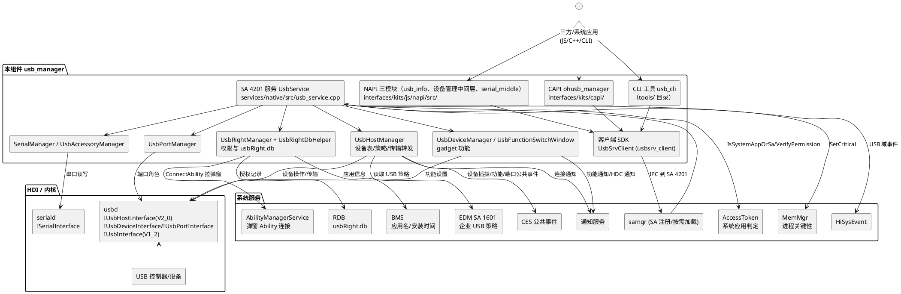

# 业务背景

> 模块：usb_manager（@ohos/usb_manager，USB 子系统，SA 4201，进程 usb_service）
> 源码依据：bundle.json、sa_profile/、services/、interfaces/、frameworks/、utils/、tools/、test/，路径均相对仓根。

## 应用定位

### 核心职责

USB 管理器（USB Manager），面向"系统统一管理与安全管控 USB"的业务问题，是应用访问 USB 能力的唯一系统入口，承担六类职责：

| 职责 | 说明 | 主要入口 |
|---|---|---|
| 主机模式设备管理 | 设备发现/描述符解析/公共事件广播、OpenDevice/Close/Reset、接口声明与配置切换 | `UsbHostManager`（services/native/src/usb_host_manager.cpp） |
| 设备数据传输 | 同步 bulk/control 传输与异步 SubmitTransfer（ashmem 共享内存 + 回调） | `UsbService::BulkTransferRead/ControlTransfer/UsbSubmitTransfer`（services/native/src/usb_service.cpp:1763/1871/2097） |
| 设备访问权限 | 应用-设备授权记录（RDB 持久化）、用户授权弹窗、系统应用旁路、记录生命周期清理 | `UsbRightManager` + `UsbRightDbHelper`（services/native/src/usb_right_manager.cpp、usb_right_db_helper.cpp） |
| 设备模式（gadget）功能 | 当前功能位图查询/设置（hdc/mtp/ptp/rndis 等）、连接状态处理、功能选择弹窗与通知 | `UsbDeviceManager`（services/native/src/usb_device_manager.cpp） |
| 端口管理 | 端口列表/支持模式查询、电源与数据角色切换 | `UsbPortManager`（services/native/src/usb_port_manager.cpp） |
| 串口与配件 | USB 串口端口发现/开关/读写/属性设置（带独立权限），AOA 配件列表/打开/关闭/授权 | `SERIAL::SerialManager`（services/native/src/serial_manager.cpp）、`UsbAccessoryManager`（services/native/src/usb_accessory_manager.cpp） |

另有系统级管控面：EDM 企业策略（禁用设备类型/全局禁用/信任列表，usb_host_manager.cpp:239 `ExecuteStrategy`）与设备安全审计上报（services/native/src/usb_security_report.cpp）。

### 职责边界（本组件不负责）

- **USB 总线驱动与设备访问执行**：由 HDI 侧 usbd（drivers_interface_usb 的 `IUsbHostInterface`/`IUsbDeviceInterface`/`IUsbPortInterface`/V1_2 `IUsbInterface`）与 seriald（`serial_interface_service`）承担，本组件只做策略、权限与转发。
- **DDK 厂商驱动接入**：由 external_device_manager 组件承担（本仓 bundle.json deps 列出该依赖，用于 peripheral_fault_notifier 等），厂商应用直连 DDK C API 不经过 SA 4201。
- **弹窗 UI 本体**：授权弹窗与功能选择弹窗由系统弹窗能力（sceneboard `com.ohos.sceneboard.systemdialog`，usb_right_manager.cpp:207）与 dialog_hap（frameworks/dialog/dialog_ui/usb_right_dialog）承载，本组件只负责拉起、参数传递与结果落库。
- **企业策略的制定与存储**：由 EDM（SA 1601，`ohos.edm.IEnterpriseDeviceMgr`）承担，本组件只读取并执行（usb_host_manager.cpp:102-103）。
- **内核驱动、充电协议栈**：不涉及；反向充电状态仅向 battery_manager 查询（usb_host_manager.cpp:1552）。

## 系统上下文

## 核心输入

| 输入类型 | 来源 | 主要内容 | 触发时机 |
|---|---|---|---|
| IPC 接口调用 | NAPI/CAPI/CLI 经 `UsbSrvClient` | 68 个 `UsbInterfaceCode` 方法（services/zidl/include/usb_service_ipc_interface_code.h:22-91），按 USB_MANAGER_FEATURE_HOST/DEVICE/PORT 宏条件编译（interfaces/innerkits/IUsbServer.idl:29-104 的 [macrodef]） | 应用调用 `@ohos.usb.*` 等 NAPI 模块（usb_info、设备管理中间层、serial_middle 三源文件） |
| HDI 设备事件 | `UsbManagerSubscriber::DeviceEvent`（V2_0，services/native/src/usb_manager_subscriber.cpp:79）或 `UsbServiceSubscriber::DeviceEvent`（V1_x，usb_service_subscriber.cpp:78） | status：ACT_DEVUP/ACT_DEVDOWN（主机插拔）、ACT_UPDEVICE/ACT_DOWNDEVICE（gadget 连接）、ACT_ACCESSORY*（配件）、ACT_CUSTOMCONTROLREQUEST | usbd 上报，经 `UsbService::DeviceEvent` 分派（usb_service.cpp:3496-3532） |
| HDI 端口事件 | 订阅者 `PortChangedEvent`（usb_manager_subscriber.cpp:35） | portId/powerRole/dataRole/mode/supportedModes | 端口角色变化 |
| 系统参数 | WatchParameter `persist.edm.usb_serial_disable`（usb_service.cpp:326-335）；串口 SysCap 常量（取值见 usb_service.cpp:321） | 串口禁用开关 | 参数变更即刻 |
| 公共事件 | `RightSubscriber` 订阅（usb_right_manager.cpp:138-155）：PACKAGE/BUNDLE/UID/USER REMOVED、USER_STOPPED、USER_SWITCHED、POWER_CONNECTED 等 | 卸载/切户/充电状态 | 用于权限记录清理与功能弹窗 |
| EDM 策略应答 | SA 1601 `ohos.edm.IEnterpriseDeviceMgr`（usb_host_manager.cpp:2031 `LoadEdmService`） | 全局禁用、禁用类型列表、信任列表（policy 码 1043/1044/1026/1059/1166，usb_host_manager.cpp:107-111） | 设备插入触发 ExecuteStrategy、EDM 上线回调 |

## 核心输出

| 输出类型 | 接收方 | 业务作用 |
|---|---|---|
| 设备列表/描述符/原始 fd | 调用应用（`GetDevices`/`GetRawDescriptor`/`GetFileDescriptor`） | 应用侧设备发现与底层访问（fd 直通） |
| 传输结果与异步回调 | 应用注册的 `IRemoteObject` 回调（`UsbSubmitTransfer`/`RegBulkCallback`） | 大数据量传输经 ashmem 共享内存完成 |
| 设备/功能/端口公共事件 | 系统与应用（COMMON_EVENT_USB_DEVICE_ATTACHED/DETACHED、USB_PORT_CHANGED 等，usb_host_manager.cpp:1539-1566） | 设备插拔通知、功能切换通知，携带设备 JSON |
| 授权结果 | 弹窗选择后经 NAPI `addDeviceAccessRight` 回流（usb_info.cpp:3227），落 usbRight.db | 决定后续 HasRight/OpenDevice 是否放行 |
| 连接通知 | `IUsbConnectionCallback::OnDeviceConnected/Disconnected`（usb_service.cpp:730-748） | 系统应用（如设置）感知应用-设备连接关系 |
| 通知栏消息 | 通知服务（`UsbConnectionNotifier`，usb_connection_notifier.h:39-56：USB_FUNC_CHARGE/MTP/PTP/MORE/反向充电/HDC） | 用户可见的连接与功能提示 |
| 观测事件 | HiSysEvent 域 USB 的 9 个事件（hisysevent.yaml:16-86：PLUG_IN_OUT_HOST_MODE/DEVICE_MODE、FUNCTION_CHANGED、PORT_ROLE_CHANGED、TRANSFER_FAULT、SERIAL_OPERATION、OPERATION_FAULT、DEVICE_SECURITY_POLICY） | 插拔行为、传输故障、串口操作、安全审计 |
| SA 自卸载指令 | samgr `UnloadSystemAbility(4201)`（usb_service.cpp:3330-3377 `UnLoadSelf`） | 30 秒无活跃设备且 gadget 未连接时回收进程 |
| HDC 状态数据 | 设置数据 datashare `HDC_STATUS`（usb_service.cpp:2956-2988） | 供设置应用展示调试模式状态 |
